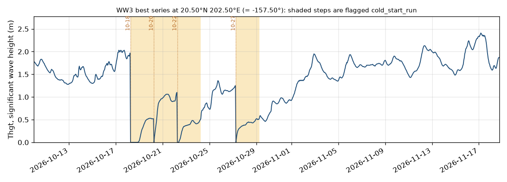

# PacIOOS WaveWatch III Hawaiʻi: Icechunk store, best time series

**[🌐 View data in browser](https://data.source.coop/ocean-icechunks/pacioos/ww3_hawaii/viewer/index.html)** · **[💻 Data access (code)](#how-to-open-it)** · **[📦 PacIOOS dataset page](https://www.pacioos.hawaii.edu/metadata/ww3_hawaii.html)** · **[📄 How to cite](#citation-and-reuse)**

An [Icechunk](https://icechunk.io) store of the **PacIOOS WaveWatch III (WW3) regional wave
model for the main Hawaiian Islands**: hourly from 2011-06-21, on a 0.05° grid (about 5 km),
with wave height, period and direction for the total sea state, the swell and the wind waves.
A new run of 181 hourly steps (7.5 days) starts every day. Its boundaries come from the University of Hawaiʻi's global
WW3 model.

```
https://data.source.coop/ocean-icechunks/pacioos/ww3_hawaii/icechunk
```

**It is the "best" time series, as PacIOOS's THREDDS and ERDDAP serve it.** The daily runs
overlap. The store has one time axis, and at each time it takes the newest run that has it. So
the past is a chain of each run's first day, and the last days are the newest run's forecast.
Three coordinates on `time` say where each value came from: `forecast_reference_time` (the run),
`forecast_period` (hours into it) and `best_step_flag` (see
[Steps to treat with care](#steps-to-treat-with-care)).

**This store is virtual.** It holds Zarr metadata and byte-range references, and no array data.
Every data read goes to the daily NetCDF files, copied unchanged from PacIOOS to Source
Cooperative at `https://data.source.coop/ocean-icechunks/pacioos/ww3_hawaii/netcdf/`.

What it adds over the files: **one dataset** instead of 5,232 overlapping files, the best-series
rule already applied, flags on the steps to treat with care, and **the metadata PacIOOS
publishes on ERDDAP**, which the files lack ([below](#where-the-metadata-came-from)).

## View it in a browser

| Field | Viewer |
|---|---|
| Significant wave height | [Open `Thgt`](https://data.source.coop/ocean-icechunks/pacioos/ww3_hawaii/viewer/index.html#icechunk+https://data.source.coop/ocean-icechunks/pacioos/ww3_hawaii/icechunk::varname=Thgt::px=0::py=0::alt=4000000::lat=20.5::lon=-158.2::dimIndices_time=0) |
| Peak wave period | [Open `Tper`](https://data.source.coop/ocean-icechunks/pacioos/ww3_hawaii/viewer/index.html#icechunk+https://data.source.coop/ocean-icechunks/pacioos/ww3_hawaii/icechunk::varname=Tper::px=0::py=0::alt=4000000::lat=20.5::lon=-158.2::dimIndices_time=0) |
| Peak wave direction | [Open `Tdir`](https://data.source.coop/ocean-icechunks/pacioos/ww3_hawaii/viewer/index.html#icechunk+https://data.source.coop/ocean-icechunks/pacioos/ww3_hawaii/icechunk::varname=Tdir::px=0::py=0::alt=4000000::lat=20.5::lon=-158.2::dimIndices_time=0) |
| Swell height | [Open `shgt`](https://data.source.coop/ocean-icechunks/pacioos/ww3_hawaii/viewer/index.html#icechunk+https://data.source.coop/ocean-icechunks/pacioos/ww3_hawaii/icechunk::varname=shgt::px=0::py=0::alt=4000000::lat=20.5::lon=-158.2::dimIndices_time=0) |
| Wind-wave height | [Open `whgt`](https://data.source.coop/ocean-icechunks/pacioos/ww3_hawaii/viewer/index.html#icechunk+https://data.source.coop/ocean-icechunks/pacioos/ww3_hawaii/icechunk::varname=whgt::px=0::py=0::alt=4000000::lat=20.5::lon=-158.2::dimIndices_time=0) |

The viewer is [gridlook](https://github.com/eeholmes/gridlook), published beside the store, and
shows all nine variables. Both the store and the NetCDF copies are on `data.source.coop`, which
sends the CORS headers a browser needs. The viewer opens at the first step, 2011-06-21T21Z.

## What is in it

One group (the root). Every variable is `(time, lat, lon)`, `float32`:

| Variable | Long name | Units | Standard name |
|---|---|---|---|
| `Thgt` | significant wave height | meters | sea_surface_wave_significant_height |
| `Tper` | peak wave period | second | sea_surface_wave_period_at_variance_spectral_density_maximum |
| `Tdir` | peak wave direction | degrees | sea_surface_wave_from_direction_at_variance_spectral_density_maximum |
| `shgt` | swell significant wave height | meters | sea_surface_swell_wave_significant_height |
| `sper` | swell peak wave period | seconds | sea_surface_swell_wave_period |
| `sdir` | swell peak wave direction | degrees | sea_surface_swell_wave_from_direction |
| `whgt` | wind significant wave height | meters | sea_surface_wind_wave_significant_height |
| `wper` | wind peak wave period | seconds | sea_surface_wind_wave_period |
| `wdir` | wind peak wave direction | degrees | sea_surface_wind_wave_from_direction |

| Coordinate | Size | Values |
|---|---|---|
| `time` | 135,094 (2026-11-16) | 2011-06-21T21Z to the end of the newest run, every hour |
| `forecast_reference_time` | on `time` | the run each step comes from (NaT if no run covers it) |
| `forecast_period` | on `time` | hours since that run's start |
| `best_step_flag` | on `time` | 0, or flags on the run a step comes from (below) |
| `lat` | 101 | 18.00 to 23.00 °N |
| `lon` | 141 | **199.00 to 206.00 °E**, that is −161.00 to −154.00 |
| `z` | scalar | 0 m (the files' depth coordinate, the sea surface) |

- **Longitude runs 0–360**, as in the files and on ERDDAP. Select with `lon=202.5`, not
  `lon=-157.5`. A virtual store cannot rewrite the coordinate's bytes; convert after reading if
  you need −180–180: `ds.assign_coords(lon=ds.lon - 360)`.
- **The time axis is regular.** 1,594 hours (11 gaps, the longest 24 days, 2015-12-06 to
  12-30) are covered by no run. They stay on the axis and read as `NaN`, with
  `forecast_reference_time` NaT. ERDDAP instead leaves them out. Every other step equals one of
  ERDDAP `ww3_hawaii`'s times (checked 2026-11-16), so
  `ds.sel(time=ds.forecast_reference_time.notnull())` gives ERDDAP's axis back.
- **The time axis is continuous**: 135,094 steps exactly one hour apart, with no gaps. An
  uncovered hour is a step of `NaN`s, never a missing step, so the series can be resampled or
  filtered as it is.
- **Land reads as `NaN`.** The files' fill value is `-999`, and readers that decode (xarray by
  default) turn it into `NaN`. The land area grows from 1,051 to 1,062 cells on 2015-12-30.
- **The swell (`s…`) and wind-wave (`w…`) fields are also `NaN` at sea** wherever the model
  found no swell or no wind sea in that cell at that time. It is in the files: at 2012-02-24T02Z
  `ww3hawaii_20120223.nc` holds `-999` in 4,837 cells of `shgt` against 1,051 land cells of
  `Thgt`. The number changes from hour to hour and is larger in the early years. The total-sea
  fields (`Thgt`, `Tper`, `Tdir`) are `NaN` only on land.
- **The files' `z` dimension of length 1 is dropped**, and `z = 0` kept as a scalar coordinate.
  The bytes referenced are the same.

## Where the metadata came from

**The NetCDF files carry almost no metadata.** Their only global attribute is a `title` padded
with dots ("WaveWatch-III results from ORE level2 model. Results provided by Ning Li, K.-F.
Cheung …"). They have no institution, license, summary, creator or coverage.

**Every global attribute in the store, and the variable and coordinate attributes, come from
PacIOOS's own ERDDAP record for this dataset,
[`ww3_hawaii`](https://pae-paha.pacioos.hawaii.edu/erddap/info/ww3_hawaii/index.html).** They
were saved on 2026-11-14 to `erddap_metadata.json` in the
[build code](https://github.com/ocean-icechunks/pacioos/tree/main/stores/ww3_hawaii), and the
build reads that copy, so a rebuild gives the same attributes. The store says so itself, in the
global attribute `metadata_source`.

What that means for each part:

- **Global attributes:** ERDDAP's, word for word (title, summary, institution, creator, license,
  keywords, `geospatial_*`, …). ERDDAP's server-only attributes (`_CoordSysBuilder`, `sourceUrl`,
  `infoUrl`, `cdm_data_type`, the `Easternmost_Easting`-style edge attributes,
  `defaultGraphQuery`, `drawLandMask`) are left out, and the time coverage is the store's own.
  The store appends the best-series rule to ERDDAP's `comment`, and adds `source_files`,
  `forecast_runs` and `metadata_source`.
- **Variable attributes:** ERDDAP's. They mostly equal the files'. Where they differ, ERDDAP's
  are newer: `Tdir` and `Tper` have the CF standard names PacIOOS corrected on ERDDAP on
  2025-05-08 (`…_at_variance_spectral_density_maximum`), and `Tper`'s units are `second`. The
  files still say `sea_surface_wave_from_direction`, `sea_surface_wave_period` and `seconds`.
  The coordinates take ERDDAP's names and axes (`Latitude`, `axis: Y`, …); `z` becomes
  `Depth`, `m`, `positive: down` (the files: "depth below mean sea level", `meters`). `time`
  keeps the files' units, minutes since 2008-01-01.
- **`_FillValue` is the files' `-999`**, not ERDDAP's `NaN`: the store serves the files' bytes.
- **`geospatial_bounds` is ERDDAP's polygon in −180–180** while `lon` is 0–360; both are as
  PacIOOS publishes them.

The table of every attribute, file value against store value, is in
[`how_store_created.md`](https://github.com/ocean-icechunks/pacioos/blob/main/stores/ww3_hawaii/how_store_created.md#attributes-file-against-store).

## Steps to treat with care

The store serves every step as ERDDAP serves it, and flags two kinds in `best_step_flag` (CF
`flag_masks` 1 and 2):

| Flag | Meaning | Steps |
|---|---|---|
| 1, `cold_start_run` | the step comes from a run that starts from an all-zero wave field | 3,856 steps, from 81 runs |
| 2, `suspect_time_label` | the step comes from one of the 8 files `ww3hawaii_20200427.nc` … `20200504.nc`, whose first time is 21Z the day **before** the name date; their times are probably a day early | 216 steps |

```python
ok = ds.where(ds.best_step_flag == 0)                      # drop both kinds
spun_up = ds.where(((ds.best_step_flag & 1) == 0) | (ds.forecast_period > 36))
```

**Cold starts.** A cold-start run begins with no waves at all, and the model takes from about
11 hours (2011) to more than a day (2024, 2026) to build them up. The best series uses the first
day of each run, so the steps it takes from a cold-start run are mostly spin-up. They are
flagged, not removed, because they are what PacIOOS serves.

**The flag does not cover all of the damage.** In October 2026 there were four cold starts in
ten days (10-18, 10-20, 10-22, 10-27), each before the last had spun up. The runs between them
are not cold starts, but they started from the under-developed wave field the cold starts left,
and stay low for days:



Between 10-18 and about 11-01 the best series shows wave heights of 0 to 1.3 m where the runs
before and after give 1.5 to 2 m. Treat that fortnight with care, flagged or not.

**Questions for PacIOOS** (also in the team's audit report):

1. Are `ww3hawaii_20200427.nc` … `20200504.nc` a day early, like the 20 files corrected in
   2024 (`ncap2 -s time[time]=time+1440`)? If so, corrected copies would go in a new version of
   the files and the store (issue #2).
2. Why are there so many cold starts in 2026: 7, four of them between 10-18 and 10-27, every
   second run? Is the restart file from the previous run not being carried over?

## How to open it

Needs **Python 3.12 or newer**, `icechunk >= 2.3`, `xarray` and `zarr`. No credentials and no
account.

```bash
pip install "icechunk>=2.3" xarray zarr
```

> **icechunk 1.x will not work.** Every icechunk 2.x release needs Python 3.12, so on an older
> Python `pip install icechunk` quietly installs 1.1.x, and the code below fails with
> `AttributeError: module 'icechunk' has no attribute 'http_storage'`.

```python
import icechunk
import numpy as np
import xarray as xr
import zarr

# Zarr's default of 10 concurrent reads is far too low for many small chunks.
zarr.config.set({"async.concurrency": 128})


def open_ww3(ref="main", chunks=None):
    """Open the PacIOOS WW3 Hawaii wave model, best time series. `ref` is a branch or tag."""
    url = "https://data.source.coop/ocean-icechunks/pacioos/ww3_hawaii/icechunk"
    repo = icechunk.Repository.open(icechunk.http_storage(url))
    # The data stay in the NetCDF files, outside the store. Allow anonymous reads of the
    # locations the store names (they are in its saved config, so no URL is hard-coded).
    auth = {p: icechunk.credentials.HttpAccess for p in repo.config.virtual_chunk_containers or []}
    repo = repo.reopen(authorize_virtual_chunk_access=auth)
    tags = set(repo.list_tags())
    session = repo.readonly_session(tag=ref) if ref in tags else repo.readonly_session(ref)
    return xr.open_zarr(session.store, consolidated=False, chunks=chunks)


ds = open_ww3()
print(ds)

# The wave-height forecast 2 days after the start of the newest run
newest_run = ds.forecast_reference_time.dropna("time").values.max()   # NaT = uncovered step
hs = ds.Thgt.sel(time=newest_run + np.timedelta64(2, "D"))

# A year of wave height north of Oʻahu (longitude is 0-360), leaving out flagged steps
series = ds.Thgt.sel(lat=21.8, lon=202.0, method="nearest").sel(
    time=slice("2025-01-01", "2025-12-31")).load()
series = series.where(series.best_step_flag == 0)
print(float(hs.max()), float(series.mean()))
print(series.forecast_reference_time.values[:5])
```

Opening takes about a second and reads only metadata.

## Reading it fast

Each chunk is **one variable at one time step**: `(1, 101, 141)`, 57 KB. That shape is fixed by
the files. The store points inside them and cannot rechunk them.

| Read | Chunks | Data moved | Time (measured) |
|---|---|---|---|
| One map, one variable | 1 | 57 KB | 0.5 s |
| One time step, all 9 variables | 9 | 0.5 MB | 2 s |
| Point series, one variable, one year (8,760 steps) | 8,760 | 0.5 GB | 7 s |
| Point series, one variable, all 135,094 steps | 135,094 | 7.7 GB | 164 s |

Measured 2026-11-16 from a JupyterHub, with `zarr.config.set({"async.concurrency": 128})` and
`chunks=None`. Rates elsewhere will differ.

- **Maps are cheap; long point series are not.** A time series at one point reads a whole 57 KB
  map at every step, because no chunk spans more than one time step. In the files the time steps
  of all nine variables are interleaved record by record, so no reference can join them. A year
  is about 8,760 reads.
- **Use `chunks=None` (the default above), or large dask chunks, for time series.** With
  `chunks={}`, dask makes one task per 57 KB chunk, which is many times slower.

## Provenance

- **Source files:** PacIOOS's daily run files `ww3hawaii_YYYYMMDD.nc` (NetCDF-3, uncompressed),
  copied unchanged from PacIOOS to Source Cooperative, each with an `.md5` beside it. 5,232
  runs, 2011-06-21 to 2026-11-11, most of them 181 hourly steps (five in 2013 are shorter).
  `ww3hawaii_20201230.nc` and `…1231.nc` sit in the `netcdf/2021/` folder, as on the PacIOOS
  server; the store references them there.
- **Built** by `build_store.py` in
  [ocean-icechunks/pacioos](https://github.com/ocean-icechunks/pacioos/tree/main/stores/ww3_hawaii).
  It read every file's header (the files come in two header layouts, so offsets differ between
  files), confirmed that all share one structure, and wrote the series in one commit on
  2026-11-16: snapshot `ZRCNA5VTJJGRR12GECW0`, 135,094 steps, 1,201,500 references.
- **Validated** from the public URL, anonymously: the covered steps equal ERDDAP's 133,500 times
  over the same span; every step comes from the newest run that has it, ties to the later file
  name, as ERDDAP; the flags agree with the file audit (81 cold starts, 8 suspect files); sampled
  planes (18 steps × 4 variables) are identical to netCDF-C reads of the files; 12 point values
  (Thgt, Tper, wdir at 4 times) equal ERDDAP's.
- **Tested with** icechunk 2.3.1, virtualizarr 2.8.0, xarray 2026.9.0, zarr 3.4.2, Python 3.12.
  The loading code above was run as written, in a clean environment holding only the three
  packages it names (and their dependencies).
- **How it was made, and how to rebuild it:**
  [`how_store_created.md`](https://github.com/ocean-icechunks/pacioos/blob/main/stores/ww3_hawaii/how_store_created.md).
  The plan and decisions are in [issue #13](https://github.com/ocean-icechunks/pacioos/issues/13).

**Updates.** For now the store covers the runs copied up to 2026-11-11. A daily update (issue
#4) will add each new run. Every update is a new Icechunk snapshot, so the series as it stood on
an earlier day stays readable.

## Citation and reuse

**The data are PacIOOS's.** Any use of this store or the NetCDF copies should cite PacIOOS, as
described at <https://www.pacioos.hawaii.edu/data-services/>. The model runs are produced by
Kwok Fai Cheung (University of Hawaiʻi at Mānoa). The license is PacIOOS's, in the store's
`license` attribute.

**The code** that copied the files and built the store was written by E. E. Holmes and is
released under the Apache License 2.0 at
[ocean-icechunks/pacioos](https://github.com/ocean-icechunks/pacioos). It can be used without
attribution.
